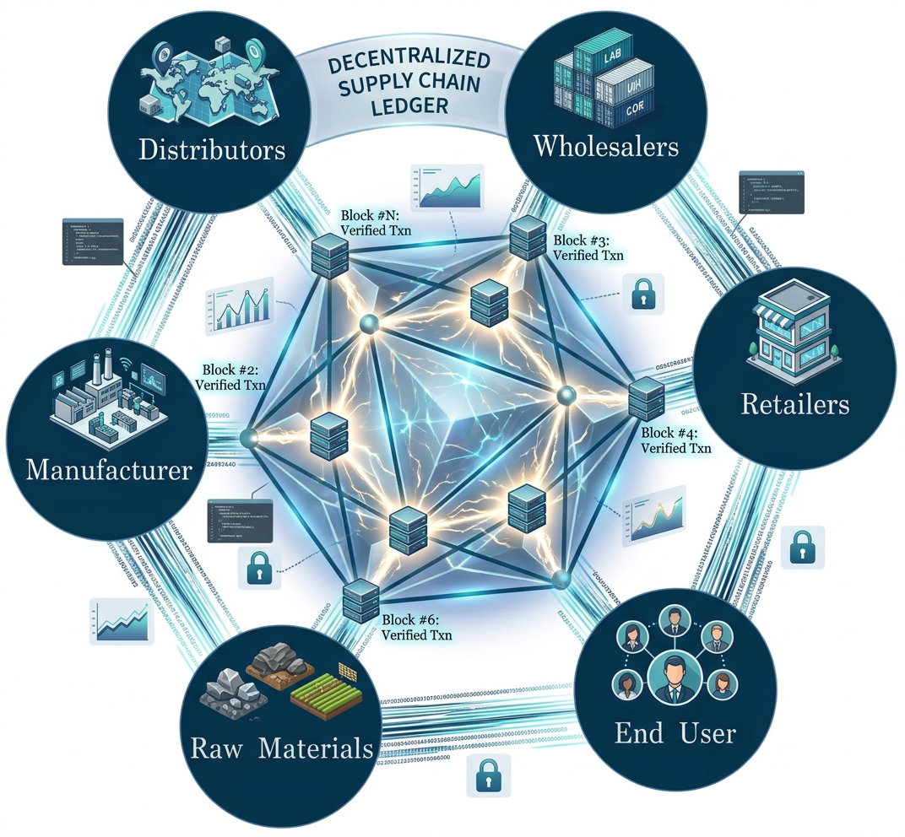
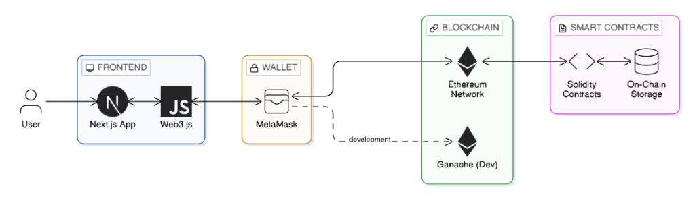
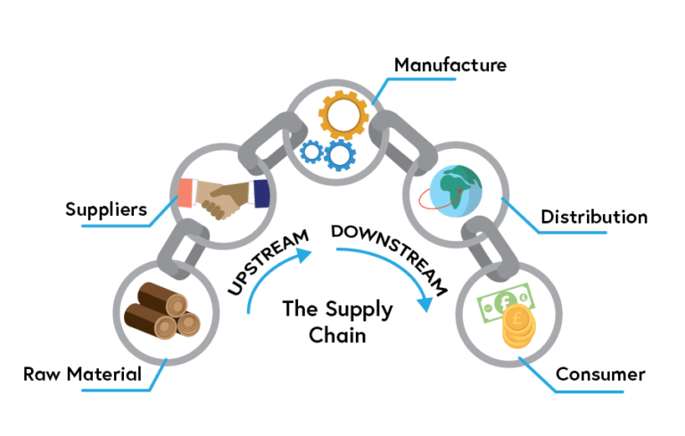
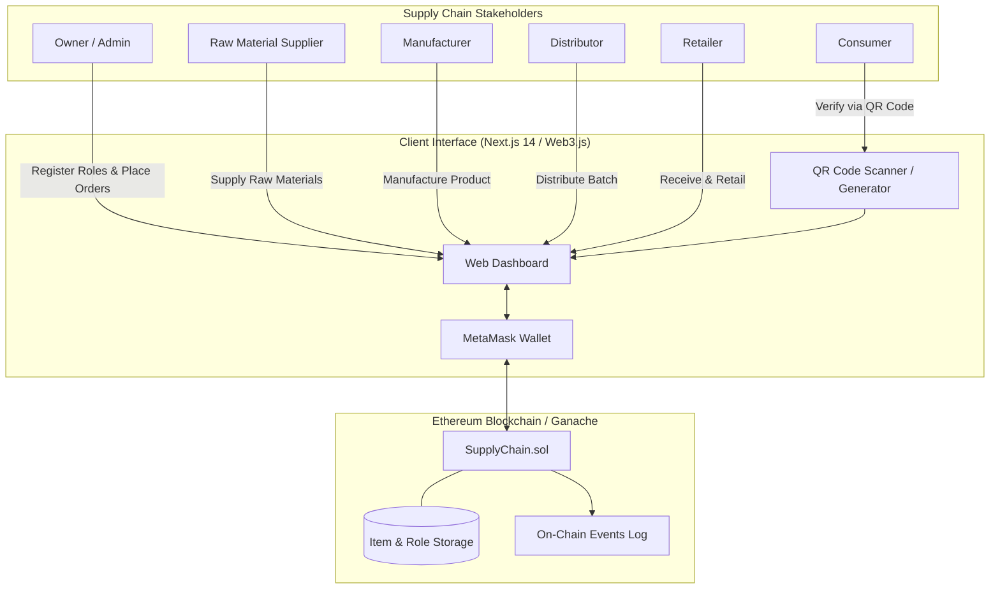
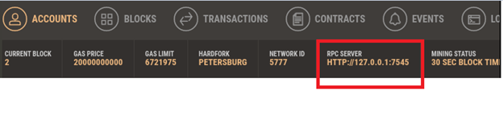
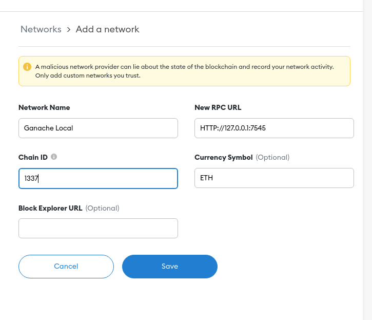
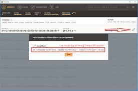
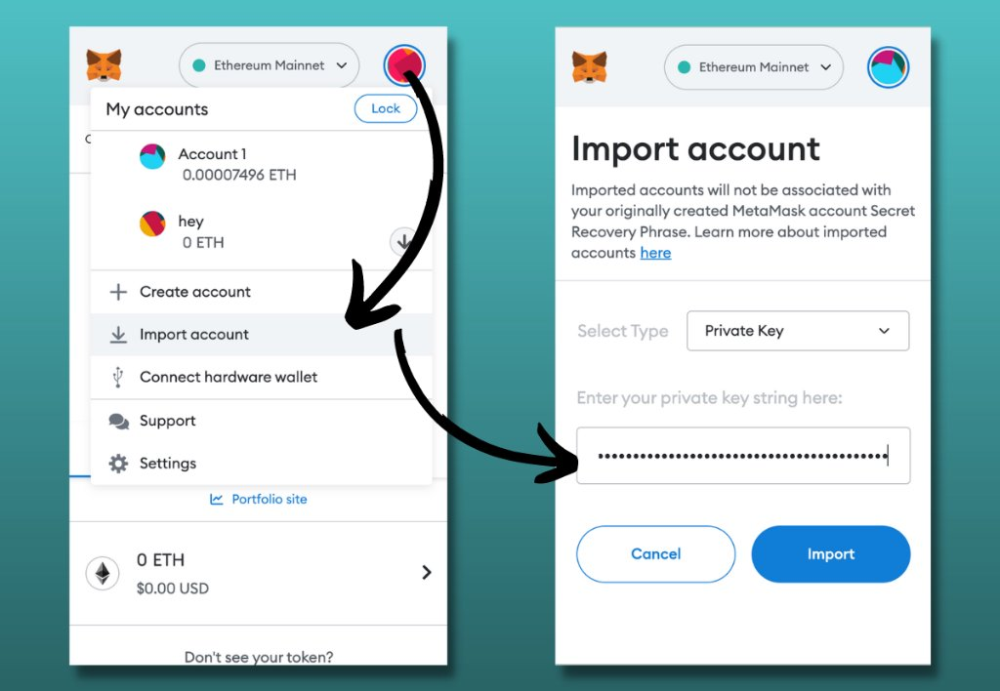
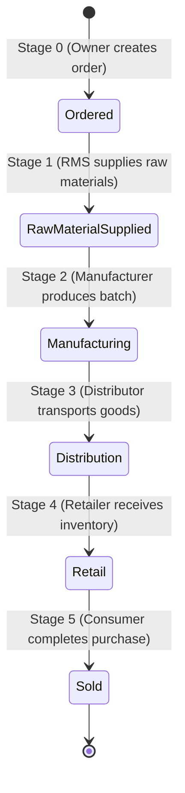
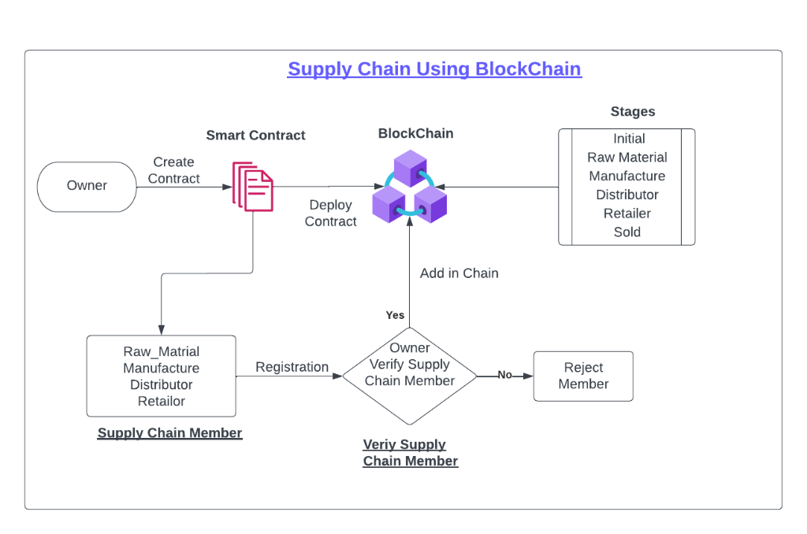

# Supply Chain Blockchain DApp

<div align="center">



**A decentralized supply chain management system built on Ethereum blockchain using Solidity smart contracts, Next.js, and Web3.js**

[](https://opensource.org/licenses/MIT)
[](https://www.typescriptlang.org/)
[](https://nextjs.org/)
[](https://soliditylang.org/)
[](https://hardhat.org/)

[Repository](https://github.com/mithulcrafts/BE) • [Report Bug](https://github.com/mithulcrafts/BE/issues) • [Request Feature](https://github.com/mithulcrafts/BE/issues)

</div>

---

## 📌 Table of Contents

- [Overview](#-overview)
  - [Problem Statement](#problem-statement)
  - [The Blockchain Solution](#the-blockchain-solution)
  - [Key Benefits](#key-benefits)
- [Features](#-features)
- [Technology Stack](#-technology-stack)
- [System Architecture](#-system-architecture)
  - [System Flow](#system-flow)
  - [Supply Chain Flow](#supply-chain-flow)
  - [Interactive Sequence & Architecture](#interactive-sequence--architecture)
- [Installation](#-installation)
  - [Prerequisites](#prerequisites)
  - [Step 1: Clone the Repository](#step-1-clone-the-repository)
  - [Step 2: Install Dependencies](#step-2-install-dependencies)
  - [Step 3: Configure Ganache](#step-3-configure-ganache)
- [Setting up Ganache (step by step)](#setting-up-ganache-step-by-step)
  - [A. Ganache Desktop (recommended)](#a-ganache-desktop-recommended)
  - [B. Ganache CLI (optional)](#b-ganache-cli-optional)
  - [Using Chain ID 5777 instead](#using-chain-id-5777-instead)
- [Step 4: Configure Hardhat](#step-4-configure-hardhat)
- [Step 5: Deploy Smart Contracts](#step-5-deploy-smart-contracts)
- [Step 6: Ganache RPC & MetaMask Setup (with Screenshots)](#step-6-ganache-rpc--metamask-setup-with-screenshots)
- [Troubleshooting](#-troubleshooting)
- [Running the Project](#-running-the-project)
- [Usage Guide](#-usage-guide)
  - [1. Register Roles](#1-register-roles)
  - [2. Order Materials](#2-order-materials)
  - [3. Manage Supply Chain Flow](#3-manage-supply-chain-flow)
  - [4. Track Products](#4-track-products)
- [Smart Contract Details](#-smart-contract-details)
  - [Roles](#roles)
  - [Product Stages](#product-stages)
  - [Key Functions](#key-functions)
  - [Data Structures & Modifiers](#data-structures--modifiers)
  - [Smart Contract Workflow Diagram](#smart-contract-workflow-diagram)
- [Security & Optimization Considerations](#-security--optimization-considerations)
- [Future Roadmap](#-future-roadmap)
- [Contributing](#-contributing)
- [Documentation & External Resources](#-documentation--external-resources)
- [License](#-license)

---

## 🌐 Overview

**Supply Chain Blockchain DApp** is an open-source, blockchain-based supply chain management application built with **Solidity smart contracts**, **Hardhat**, **Next.js 14**, **Web3.js**, and **MetaMask**. It demonstrates how to build an end-to-end Ethereum decentralized application (dApp) for transparent, secure, and verifiable supply chains (specifically applied to pharmaceuticals, consumer goods, and multi-tier logistics).

### Problem Statement
Traditional enterprise supply chains operate through fragmented, proprietary silos and manual paper documentation:
* **Counterfeit Infiltration:** Substandard or fake goods (such as counterfeit medicines) enter transit hubs undetected.
* **Lack of Visibility:** Upstream suppliers and downstream distributors rarely share real-time status updates.
* **Tamper Vulnerabilities:** Centralized databases can have their history altered retroactively or corrupted by human error.
* **Audit Latency:** Tracing the provenance of recalled batches can take days or weeks of manual paper checks.

### The Blockchain Solution
By implementing immutable smart contracts on the Ethereum Virtual Machine (EVM):
* Every transition is signed by an authorized participant's private key.
* Product state transitions are strictly deterministic—items cannot skip verification checkpoints.
* Consumers and auditors can instantly scan product QR codes to inspect the entire on-chain custody history.

### Key Benefits

* **Transparency:** All transactions and product movements are recorded on the distributed ledger.
* **Security:** Immutable records prevent retrospective tampering, falsification, and fraud.
* **Efficiency:** Automated smart contract state checks reduce administrative overhead and paperwork.
* **Traceability:** Complete journey mapping from raw materials to final consumer delivery.
* **Decentralization:** No single point of failure or centralized gatekeeper.

---

## ✨ Features

* **Role-Based Access Control (RBAC):** Secure role verification ensuring only authorized stakeholders (Owner, Raw Material Supplier, Manufacturer, Distributor, Retailer) can trigger specific supply chain transitions.
* **Product Management:** Create orders, track item lifecycles, and monitor custody transitions on-chain.
* **Supply Chain Flow Engine:** Strict state progression (`Order` ➔ `Raw Material Supply` ➔ `Manufacturing` ➔ `Distribution` ➔ `Retail` ➔ `Sold`).
* **Real-Time Tracking & Dynamic QR Codes:** Inspect complete audit trails with instant QR code generation and camera scanning.
* **Modern Next.js 14 UI:** Clean, responsive user interface built using Tailwind CSS and TypeScript.
* **Web3 Integration:** Direct wallet detection and transaction handling via MetaMask and Web3.js.
* **Mobile Responsive:** Fully optimized for desktop, tablet, and mobile browsers.

---

## 💻 Technology Stack

### Frontend
* **Next.js 14** – React framework with modern App Router
* **TypeScript** – Type-safe application and Web3 client logic
* **Tailwind CSS** – Utility-first CSS styling
* **Web3.js** – Ethereum JSON-RPC client for smart contract interactions
* **QRCode.react** & **html5-qrcode** – Dynamic QR code generation and scanner

### Backend / Blockchain
* **Solidity (`^0.8.19`)** – Smart contract programming language
* **Hardhat** – Ethereum development environment, testing, and deployment
* **Ganache** – Personal local Ethereum blockchain for development
* **MetaMask** – Web3 wallet and transaction signer

### Development Tools
* **Node.js 18+** – JavaScript/TypeScript runtime
* **npm / yarn** – Package management
* **Git** – Version control

---

## 🏛 System Architecture

<p align="center">
  
</p>

The application follows a modular decentralized architecture:

1. **Smart Contracts (Solidity):** Handle all core business logic, permissions, and data persistence directly on the Ethereum ledger.
2. **Frontend (Next.js):** Provides intuitive dashboards for all roles and interfaces with contracts via Web3.js.
3. **MetaMask:** Acts as the cryptographic bridge and wallet for signing on-chain transactions.
4. **Ganache / Ethereum Network:** Provides consensus, block validation, and distributed state storage.

### System Flow

```text
User ➔ Next.js Frontend ➔ Web3.js ➔ MetaMask ➔ Ethereum Network / Ganache ➔ Smart Contract
```

### Supply Chain Flow

The physical and digital journey of each product item through the supply chain:

```text
Order ➔ Raw Material Supplier ➔ Manufacturer ➔ Distributor ➔ Retailer ➔ Consumer
```

<p align="center">
  
</p>

### Interactive Sequence & Architecture



---

## 🚀 Installation

### Prerequisites

Before you begin, ensure you have the following installed:

* **Node.js** (v18 or higher) – [Download](https://nodejs.org/)
* **Git** – [Download](https://git-scm.com/downloads)
* **Ganache** – [Download](https://trufflesuite.com/ganache/)
* **MetaMask** – [Chrome Extension](https://chrome.google.com/webstore/detail/metamask) | [Firefox Add-on](https://addons.mozilla.org/en-US/firefox/addon/ether-metamask/)
* **VS Code** (Recommended) – [Download](https://code.visualstudio.com/)

---

### Step 1: Clone the Repository

```bash
git clone https://github.com/mithulcrafts/BE.git
cd BE
```

---

### Step 2: Install Dependencies

1. **Install backend dependencies (Hardhat & Smart Contracts):**
   ```bash
   cd backend
   npm install
   cd ..
   ```

2. **Install client dependencies (Next.js & Web3):**
   ```bash
   cd client
   npm install
   cd ..
   ```

---

### Step 3: Configure Ganache

Follow the detailed walkthrough below: **[Setting up Ganache (step by step)](#setting-up-ganache-step-by-step)**. In short, use **RPC `http://127.0.0.1:7545`** and **Chain ID `1337`** so they match `backend/hardhat.config.ts` (`networks.ganache`) and the keys in `client/src/deployments.json`.

---

## ⚙️ Setting up Ganache (step by step)

This project’s default Hardhat network `ganache` uses **`http://127.0.0.1:7545`** and **chain ID `1337`**. MetaMask, Ganache, and Hardhat must all use the **same** RPC URL and **chain ID** (EIP-155), or you will see "wrong network" or "contract not found".

### A. Ganache Desktop (recommended)

1. **Install Ganache:** Download and install [Ganache](https://trufflesuite.com/ganache/) (Truffle Suite).
2. **Create a workspace:** Open Ganache ➔ **New Workspace** (or open an existing workspace). A workspace persists accounts and settings across restarts; **Quickstart** resets when you close the app.
3. **Open workspace settings:** Click the **gear / Settings** icon for the workspace.
4. **Server (host and port):**
   * **HOSTNAME:** `127.0.0.1` (use this in MetaMask on the same machine).
   * **PORT:** `7545`  
   * *This must match `networks.ganache.url` in `backend/hardhat.config.ts` (`http://127.0.0.1:7545`).*
5. **Chain ID:**
   * Set **Chain ID** (or **EIP-155 Chain ID**) to **`1337`**.  
   * If the UI only shows **NETWORK ID**, set it to **`1337`** so it stays consistent with Hardhat’s `ganache` network and the frontend’s default deployment entry.
6. **Save and restart:** Save settings and **restart** the workspace if Ganache prompts you.
7. **Confirm RPC:** On the main **Accounts** screen, check that the **RPC SERVER** is `HTTP://127.0.0.1:7545`.
8. **Deployer account:** Hardhat uses Ganache’s **first account** by default. In MetaMask, import that account’s **private key** (key icon in Ganache) if you need to act as the contract **owner**.

> **Note:** After you change chain ID or reset the chain, redeploy the contract (`npx hardhat run scripts/deploy.ts --network ganache` from `backend`) so `client/src/deployments.json` gets a valid address for the current chain.

### B. Ganache CLI (optional)

If you use the [Ganache CLI](https://github.com/trufflesuite/ganache) instead of the desktop app, start a node that matches the same host, port, and chain ID:

```bash
npx ganache --host 127.0.0.1 --port 7545 --chain.chainId 1337
```

Leave this process running, then deploy from `backend` with `--network ganache` as usual.

### Using Chain ID 5777 instead

If your Ganache instance must use **chain ID `5777`**, use Hardhat’s `ganache5777` network and deploy with:

```bash
cd backend
npx hardhat run scripts/deploy.ts --network ganache5777
```

Ensure MetaMask’s **Chain ID** is **5777** and that `client/src/deployments.json` includes a `"5777"` entry after deploy.

---

## 🛠 Step 4: Configure Hardhat

Check `backend/hardhat.config.ts` to ensure your Ganache network settings are aligned:

```typescript
networks: {
  ganache: {
    url: "http://127.0.0.1:7545", // Your Ganache RPC URL
    chainId: 1337,                 // Your Ganache Chain ID
    accounts: {
      mnemonic: "your ganache mnemonic" // Optional: if using mnemonic
    }
  }
}
```

---

## 📦 Step 5: Deploy Smart Contracts

All Hardhat commands must be run from the **`backend`** folder (where `hardhat.config.ts` lives).

1. Compile the smart contracts:
   ```bash
   cd backend
   npx hardhat compile
   ```

2. Deploy to Ganache:
   ```bash
   npx hardhat run scripts/deploy.ts --network ganache
   ```

The deployment script will automatically update `client/src/deployments.json` with the new contract address.

---

## 🦊 Step 6: Ganache RPC & MetaMask Setup (with Screenshots)

Use the same **RPC URL** and **chain ID** everywhere: Ganache, `backend/hardhat.config.ts`, MetaMask, and `client/src/deployments.json` (defaults: `http://127.0.0.1:7545`, chain ID **1337**).

### 1. Read the RPC Server URL from Ganache
You will paste this into MetaMask in the next step.

<p align="center">
  
</p>

### 2. Add the Network in MetaMask
In MetaMask, click the network dropdown ➔ **Add network** ➔ **Add a network manually**, then fill in:

* **Network name:** `Ganache Local`
* **RPC URL:** `http://127.0.0.1:7545`
* **Chain ID:** `1337` (must match Ganache and Hardhat `networks.ganache`)
* **Currency symbol:** `ETH`

Save and **select this network** before using the dApp.

<p align="center">
  
</p>

### 3. Copy the Deployer Private Key from Ganache
Hardhat deploys with Ganache’s **first account** by default. That address is the contract **owner** (Register Roles, Order Materials). Copy its private key by clicking the key icon on Account (0).

<p align="center">
  
</p>

### 4. Import the Account into MetaMask
In MetaMask: Click Account menu ➔ **Import account** ➔ paste the private key ➔ **Import**. Keep this account selected when acting as the contract owner.

<p align="center">
  
</p>

### 5. Run the App
From the `client` directory:
```bash
cd client
npm run dev
```
Open [http://localhost:3000](http://localhost:3000). The deploy log line `Deploying with account: 0x...` must match the **active** MetaMask account for owner-only actions.

---

## 🔍 Troubleshooting

**Chain ID `5777` vs `1337`:** Some documentation confuses **network ID** with **chain ID** (EIP-155). This project expects **chain ID** to match everywhere. If Ganache uses **5777**, deploy with `npx hardhat run scripts/deploy.ts --network ganache5777` from `backend` and ensure `client/src/deployments.json` has a `"5777"` entry after deploy.

| Symptom | Probable Cause | What to Check & Fix |
| :--- | :--- | :--- |
| **"Only owner can do this"** | Active MetaMask account is not the deployer. | Active MetaMask account must be the **same address** that deployed the contract (see deploy log). Import Account (0) from Ganache. |
| **"Contract not found" / Wrong network banner** | Stale contract address or chain mismatch. | Chain ID in MetaMask must match the key in `client/src/deployments.json`. After resetting Ganache, **redeploy**—old addresses become invalid. |
| **1337 in settings but 5777 in console** | Network ID vs Chain ID confusion. | Align **chain ID** everywhere; redeploy after updating Ganache settings. |
| **Transaction fails or wrong balance** | RPC pointing to wrong instance. | RPC URL in MetaMask must point to the **same** active Ganache instance (`127.0.0.1:7545`). |
| **Nonce too high error** | Resetting chain while MetaMask cached nonces. | In MetaMask: **Settings ➔ Advanced ➔ Clear activity tab data**. |

---

## 🏃 Running the Project

If you have already followed the **Installation** steps, you only need to run:

1. **Ganache:** Keep Ganache running with the same RPC/chain ID as `backend/hardhat.config.ts`.
2. **Deploy (if reset):**
   ```bash
   cd backend
   npx hardhat run scripts/deploy.ts --network ganache
   ```
3. **Frontend:**
   ```bash
   cd client
   npm run dev
   ```
   Open: [http://localhost:3000](http://localhost:3000)

**Production build:**
```bash
cd client
npm run build
npm start
```

---

## 📖 Usage Guide

### 1. Register Roles
* Navigate to the **"Register Roles"** page (`/roles`).
* **Only the contract owner** can register new roles.
* Add participants: **Raw Material Suppliers (RMS)**, **Manufacturers (MAN)**, **Distributors (DIS)**, and **Retailers (RET)**.
* Each registration requires: Ethereum Address, Name, and Geographic Location.

### 2. Order Materials
* Go to the **"Order Materials"** page (`/order`).
* **Only the contract owner** can create new material orders.
* Enter product details: Product ID, Name, Description, and select assigned RMS, MAN, DIS, and RET addresses.
* Ensure at least one participant of each role is registered before creating an order.

### 3. Manage Supply Chain Flow
* Access the **"Supply Chain Flow"** page (`/flow`).
* Connect the appropriate MetaMask account for each step:
  * **Raw Material Supplier:** Signs and executes raw material supply.
  * **Manufacturer:** Fabricates and packages the finished item.
  * **Distributor:** Dispatches and logs transit tracking.
  * **Retailer:** Checks in inventory and marks units as sold to consumers.

### 4. Track Products
* Visit the **"Track Materials"** page (`/track`).
* Enter a Product ID (or scan the item's QR code).
* View the complete verified journey: timestamps, stage statuses, and custodian addresses.
* Download or display the generated QR code for physical packaging.

---

## 📜 Smart Contract Details

The `SupplyChain.sol` smart contract implements a full supply chain tracking system: it records product **stages**, stores metadata (names, descriptions, timestamps), and defines granular **roles** (Raw Material Supplier, Manufacturer, Distributor, Retailer). The **owner** registers participants and creates orders; individual role-holders advance products through authorized stage transitions.

### Roles

* **Owner:** Deploys the contract, registers participants, and creates product orders.
* **Raw Material Supplier (RMS):** Sources raw materials and initiates the physical product flow.
* **Manufacturer (MAN):** Fabricates and packages the finished medicine/goods.
* **Distributor (DIS):** Manages wholesale distribution and transportation.
* **Retailer (RET):** Stocks goods on shelves and registers customer purchases.

### Product Stages



1. **Ordered** (Stage 0): Product order created by owner.
2. **Raw Material Supplied** (Stage 1): Raw materials supplied by RMS.
3. **Manufacturing** (Stage 2): Product manufactured and packaged by Manufacturer.
4. **Distribution** (Stage 3): Product in transit with Distributor.
5. **Retail** (Stage 4): Product received at retail facility.
6. **Sold** (Stage 5): Product sold to final consumer.

### Key Functions

* `addRMS()`, `addManufacturer()`, `addDistributor()`, `addRetailer()`: Register new supply chain participants (Owner only).
* `addMedicine()`: Create new product orders with assigned participants.
* `RMSsupply()`, `Manufacturing()`, `Distribute()`, `Retail()`, `sold()`: Progress products sequentially through stages.
* `showStage()`: Read-only query returning the current lifecycle stage of an item.

### Data Structures & Modifiers

```solidity
enum STAGE {
    Init,
    RawMaterialSupplied,
    Manufacture,
    Distribution,
    Retail,
    Sold
}

struct medicine {
    uint256 id;
    string name;
    string description;
    uint256 RMSid;
    uint256 MANid;
    uint256 DISid;
    uint256 RETid;
    STAGE stage;
}
```

### Smart Contract Workflow Diagram

<p align="center">
  
</p>

---

## 🛡 Security & Optimization Considerations

1. **Role Enforcement:** All stage-transition functions use modifier checks (`onlyOwner`, `onlyRMS`, etc.) to prevent unauthorized callers from progressing batches.
2. **Deterministic Sequence:** Functions enforce `require(stage == STAGE.Expected)` checks to ensure no product can bypass upstream quality controls or checkpoints.
3. **Storage Efficiency:** Uses numeric enums rather than dynamic strings for lifecycle stages to minimize EVM gas costs.
4. **Event Logging:** Crucial state modifications emit on-chain events, enabling low-cost off-chain indexing without redundant contract reads.

---

## 🔮 Future Roadmap

- [ ] **IoT Sensor Integration:** Connect Chainlink Oracles to monitor temperature and humidity sensors in transit (vital for cold-chain vaccines).
- [ ] **IPFS Document Pinning:** Anchor laboratory purity certificates and customs clearance paperwork to decentralized storage.
- [ ] **L2 Rollup Deployment:** Deploy on Arbitrum / Polygon Sepolia testnets for near-zero transaction fees and instant finality.
- [ ] **Decentralized Identifiers (DIDs):** Incorporate W3C verifiable credentials for automated supplier identity vetting.

---

## 🤝 Contributing

Contributions are welcome! Please follow these steps:

1. Fork the repository
2. Create your feature branch (`git checkout -b feature/AmazingFeature`)
3. Commit your changes (`git commit -m 'feat: Add some AmazingFeature'`)
4. Push to the branch (`git push origin feature/AmazingFeature`)
5. Open a Pull Request

### Contribution Guidelines
* Follow existing TypeScript and Solidity code formatting conventions.
* Add unit tests in `backend/test` for any smart contract modifications.
* Update documentation for any new endpoints or contract events.
* Follow the project [CODE_OF_CONDUCT.md](./CODE_OF_CONDUCT.md) and [CONTRIBUTING.md](./CONTRIBUTING.md).

---

## 📚 Documentation & External Resources

* [Solidity Documentation](https://docs.soliditylang.org/en/v0.8.19/)
* [Next.js Documentation](https://nextjs.org/docs)
* [React Documentation](https://reactjs.org/docs/getting-started.html)
* [Hardhat Documentation](https://hardhat.org/docs)
* [Web3.js Documentation](https://web3js.readthedocs.io/)
* [Ganache Documentation](https://trufflesuite.com/docs/ganache/overview)
* [MetaMask Documentation](https://docs.metamask.io/)

---

## 📄 License

This project is licensed under the MIT License – see the [LICENSE](LICENSE) file for details.

---

<div align="center">

**Made with Solidity, Next.js, and Web3**

[Back to Top](#supply-chain-blockchain-dapp)

</div>
